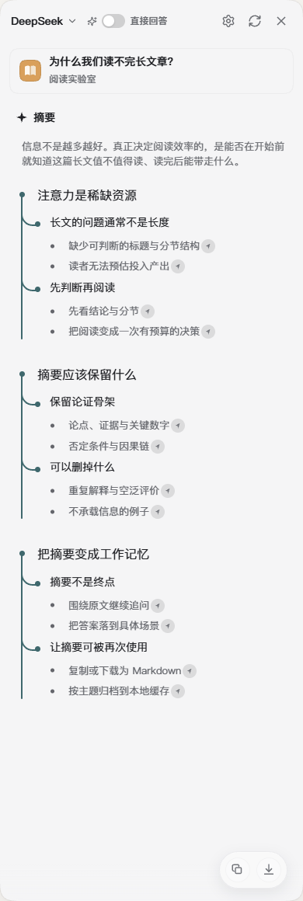
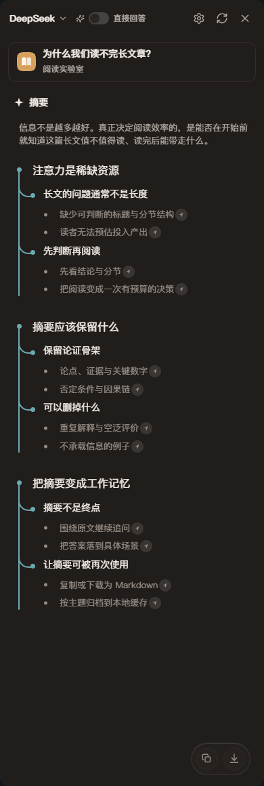
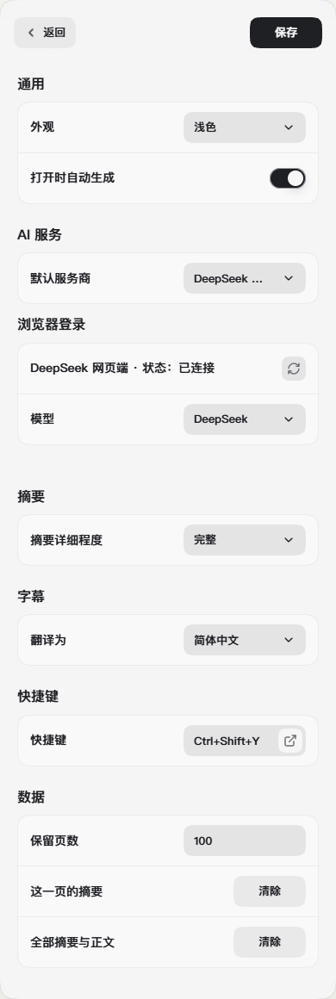

# 摘意（Zhaiyi）— 网页摘要助手

摘意是一个 Chrome/Edge Manifest V3 扩展：在当前网页打开一个紧凑浮窗，自动抽取正文或视频字幕，生成结构化摘要，并支持围绕摘要继续追问。


## 界面预览

<p align="center">
  
  
</p>
<p align="center">
  
</p>

## 功能

- 点击扩展图标或按 `Ctrl+Shift+Y`（macOS：`Command+Shift+Y`）打开浮窗并自动总结当前页面。
- 普通网页使用 Readability 风格正文抽取，过滤导航、页脚、评论和广告。
- YouTube / Bilibili 优先读取字幕；字幕缺失时回退到正文。
- 抖音使用可见字幕/页面文本的尽力模式。
- 支持自定义 OpenAI-compatible API，以及使用已登录会话的 DeepSeek 网页端。
- 在浮窗设置里填写 API Key、Base URL，拉取并选择模型。
- 摘要与对话可分别设置输出详细程度。
- 支持自动/浅色/深色主题、拖动、收起、本地缓存和继续追问。

## 支持站点

普通网页、YouTube、Bilibili、抖音、Google Docs、linux.do（Discourse）等。其他站点走通用正文抽取。

## 直接下载

如果不想本地构建，可以在 [Releases](https://github.com/Jiangshishou/zhaiyi-web-summary-assistant/releases) 下载 `zhaiyi-web-summary-assistant-v1.26.zip`，解压后在 `chrome://extensions` 里选择「加载已解压的扩展程序」，指向解压后的目录。Chrome 不支持直接双击安装未上架的 `.crx`，所以这里提供的是 zip 包。

## 安装（从源码构建）

需要 Node.js 20.19+ 或 22.12+。

```bash
npm install
npm run build
```

构建产物在 `dist/`。

1. 打开 `chrome://extensions`（Edge 为 `edge://extensions`）。
2. 打开右上角「开发者模式」。
3. 点击「加载已解压的扩展程序」，选择本项目的 `dist/` 目录。
4. 打开任意网页，点击扩展图标或按 `Ctrl+Shift+Y`。

## 配置

- **自定义 provider**：在浮窗设置里填写 Base URL、API Key，点击拉取模型并选择默认模型。
- **DeepSeek 网页端**：先在浏览器登录 `chat.deepseek.com`，扩展会复用该会话。
- API Key 只保存在浏览器本地 `chrome.storage`，不会写入仓库。

## 隐私

- 本扩展没有自有服务器，不收集、不上传使用统计。
- 摘要请求会直接发送到你在设置中选择的模型服务商；发送内容是当前页面的正文或视频字幕。
- API Key、模型配置和页面缓存只保存在本地浏览器存储中。
- 扩展申请 `<all_urls>` 权限是为了在任意网页上读取正文；是否读取由你点击扩展或快捷键触发。

## 开发

```bash
npm install
npm run typecheck
npm run lint
npm run build
```

## License

[MIT](LICENSE)

## 致谢

感谢 [Linux Do 论坛](https://linux.do) 的讨论与反馈。
